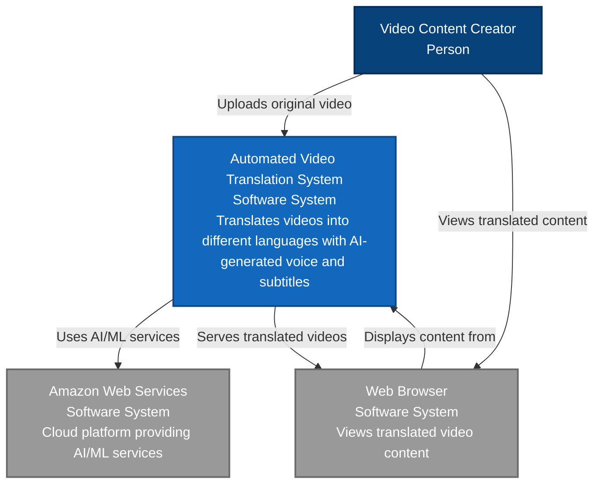
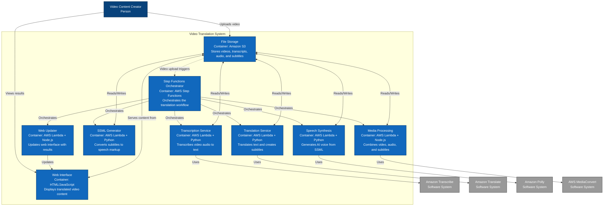
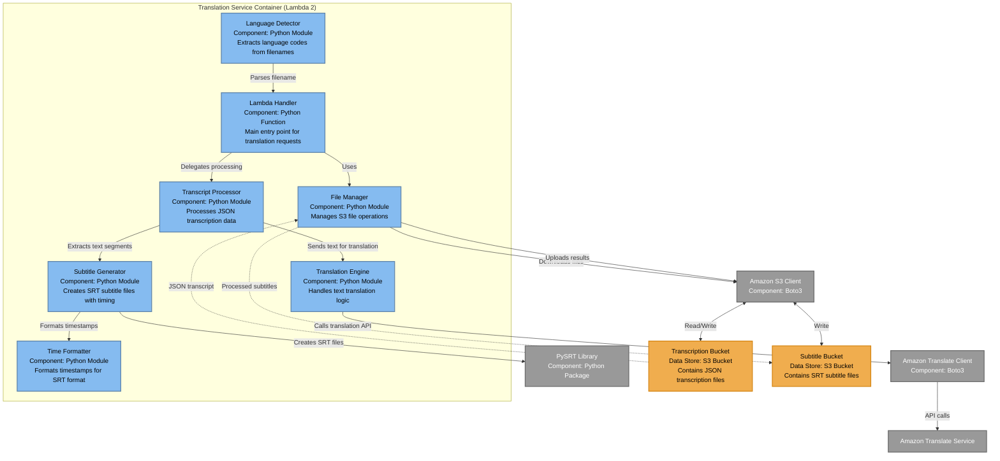

# C4 Model Diagrams for Video Translation Application

This document contains C1, C2, and C3 diagrams for the automated video translation and transcoding pipeline using the C4 model architecture.

## C1 - System Context Diagram

This diagram shows the high-level view of the video translation system and how users and external systems interact with it.

## C2 - Container Diagram

This diagram shows the high-level technology choices and how responsibilities are distributed across containers within the video translation system.

## C3 - Component Diagram (Translation Service)

This diagram shows the internal components of the Translation Service Lambda function, which is one of the core components handling text translation and subtitle generation.

## Architecture Flow Summary

The system follows this high-level flow:

1. **User uploads video** → Triggers Step Functions workflow
2. **Transcription** → Converts audio to text using Amazon Transcribe
3. **Translation & Subtitles** → Translates text and creates SRT files
4. **SSML Generation** → Converts subtitles to speech markup language
5. **Speech Synthesis** → Generates AI voice using Amazon Polly
6. **Media Processing** → Combines original video with new audio and subtitles
7. **Web Update** → Makes translated video available through web interface

Each Lambda function is responsible for a specific step in this pipeline, with Step Functions orchestrating the entire workflow and S3 providing persistent storage for all intermediate and final outputs.